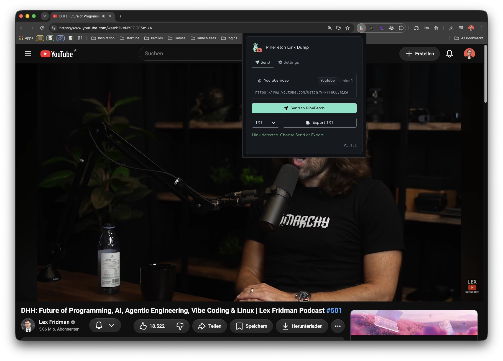
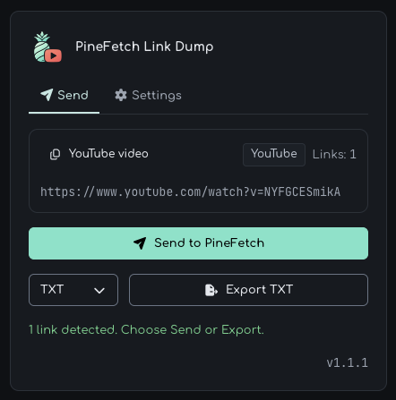
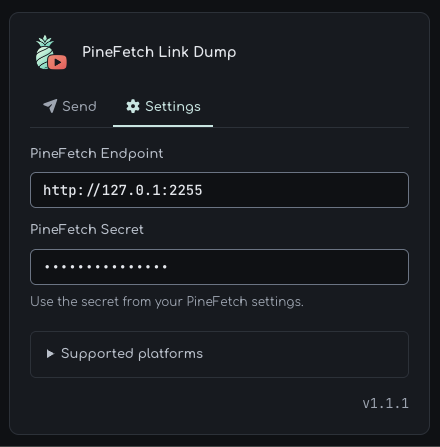

  

# PineFetch Link Dump 🍍

 

PineFetch Link Dump is a Chrome extension for collecting video links from the page you are viewing.
It saves you from copying links one by one across videos, profiles, and feeds.
You can export the collected links or send them directly to your local PineFetch queue.

Open a video or scroll a profile or feed to load the posts you want, then open the extension to review the detected links.
Choose TXT, JSON, or CSV to save a file, copy the links, or send them to PineFetch for downloading.
Only links already loaded on the page are collected, so scroll further before opening the extension if you need more.

## What it does

- Collect links from YouTube, TikTok, Instagram, Reddit, X, and Facebook.
- Detect direct HTTP(S) video sources on other web pages.
- Preview detected links and copy them to the clipboard.
- Export plain link lists as TXT or save source and page details with JSON and CSV.
- Send one video or a batch of links to a local PineFetch instance.

## Install

Requires desktop Google Chrome 114 or later on Windows, macOS, or Linux.
Copying and exporting links work without PineFetch; sending links requires [PineFetch](https://oliverjessner.at/pinefetch/) running on the same computer.

### Download

1. Download the [packaged extension ZIP (v1.1.1)](https://raw.githubusercontent.com/oliverjessner/PineFetch-Link-Dump/main/dist/PineFetch-Link-Dump-1.1.1.zip) and extract it into a permanent folder.
2. Open `chrome://extensions` in Chrome and enable **Developer mode**.
3. Click **Load unpacked** and select the extracted folder containing `manifest.json`.
4. Open the extension from Chrome's toolbar on a supported page.

See the [latest GitHub release](https://github.com/oliverjessner/PineFetch-Link-Dump/releases/latest) for the latest published release. The packaged ZIP above is distributed in this repository.

## Collect links from videos, profiles, and feeds

Use a single video page or collect loaded links from YouTube channels and lists, TikTok profiles and music pages, Instagram profiles, Reddit listings, X timelines, and Facebook video pages. Duplicate links are removed automatically.

For TikTok short links, open the link first and use the extension on the resulting video page. Reddit and X listings can include posts without video, which PineFetch may be unable to download.

## Copy links or export a file

Click the copy control above the detected links or choose an export format and click **Export**. TXT saves one link per line; JSON adds the source, page URL, title, collection time, and link count, while CSV saves one link per row with source and page details.

## Send links to your PineFetch queue

Start PineFetch, open the extension's **Settings** tab, and enter the endpoint and secret from your PineFetch settings; changes are saved automatically. The default endpoint is `http://127.0.1:2255`; return to **Send** and click **Send to PineFetch** to queue the detected links.

## Who it is for

- PineFetch users queuing videos while browsing.
- Journalists and researchers collecting links from profiles and feeds.
- Content archivists saving link lists with source and page details.

## Changelog

See the [changelog](docs/changelog.md) for release notes and changes.

## License

MIT
